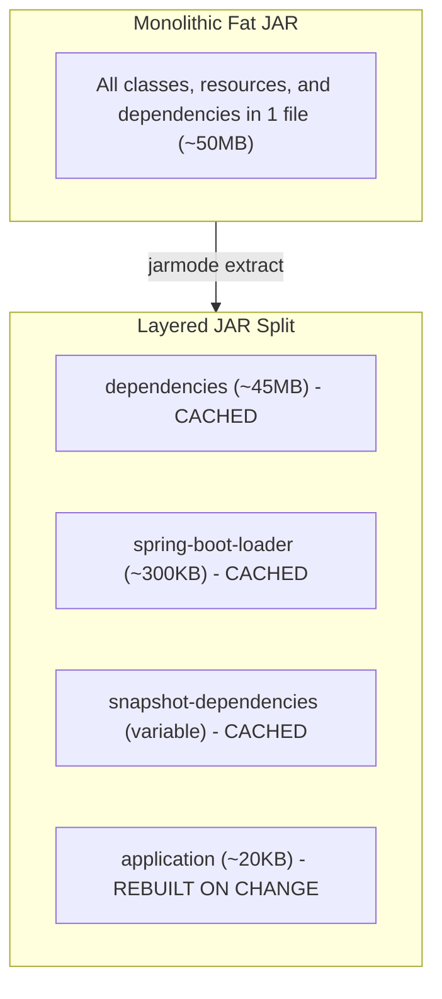

# Lab 2: Layered JARs & BuildKit Layer Caching

In this lab, you learn how to solve the "fat JAR" problem by utilizing Spring Boot 3's built-in **Layered JAR** architecture and Docker's layer cache mechanism.

---

## 1. What are Layered JARs?

In standard Spring Boot packaging, all compiled classes, resources, and external Maven dependencies (`.jar` files from Spring, Hibernate, Jackson, etc.) are bundled into a single monolithic `.jar`.

Spring Boot 3 includes a layer index (`layers.idx`) that partitions the contents into four distinct logical layers:
1. `dependencies`: Third-party release dependencies (Spring, Hibernate, etc.). These rarely change.
2. `spring-boot-loader`: The internal bootstrap code that boots the Spring application.
3. `snapshot-dependencies`: Internal organization SNAPSHOT libraries.
4. `application`: Your actual application classes (`.class`), templates, and `application.yaml`.



---

## 2. Docker Layer Ordering Principle

Docker caches each layer sequentially. If a layer changes, **all subsequent layers are invalidated**.

Therefore, following the [Docker build cache guidance](https://docs.docker.com/build/cache/):
```dockerfile
# 1. Least frequently changed layer first
COPY --link --from=extractor /layers/dependencies/ ./

# 2. Next least frequent
COPY --link --from=extractor /layers/spring-boot-loader/ ./
COPY --link --from=extractor /layers/snapshot-dependencies/ ./

# 3. Most frequently changed layer last
COPY --link --from=extractor /layers/application/ ./
```

Notice the use of `--link` in `COPY --link`: This makes each layer independent of the files in the previous layers, optimizing cache reuse across builds.

---

## 3. Hands-On Exercise

### Step 1: Build the layered image
The Dockerfile packages the app using Maven, then extracts the Spring Boot layers. No host JDK or Maven is needed.
```bash
docker build -f labs/02-layered-jars/Dockerfile.layered -t spring-boot-layered:1.0 .
```

### Step 2: Run the Benchmark Script
Run the automated benchmark to compare rebuilds after a small source change:
```bash
./labs/02-layered-jars/benchmark.sh
```

Inspect the build output to see which layer copies are reused. Build time depends on the local cache and registry state.

---

## 4. Key Takeaways
- Layered JARs allow registries to reuse unchanged dependency layers; the actual transfer depends on the registry and changed files.
- Ordering matters: always copy least-frequently changed files first.
- In **Lab 3**, we use a smaller JRE runtime image and explore a custom JRE.
