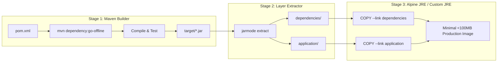

# Lab 3: Advanced Multi-Stage Builds & Minimal Runtimes

In this lab, you eliminate any host-level dependencies (such as having Java or Maven installed on your machine) by running the compilation and packaging inside a dedicated builder container, then copying only the necessary artifacts into a minimal runtime image.

---

## 1. Why Multi-Stage Builds?

Labs 1 and 2 already package the app in a builder stage. Here we also separate the build tools from the final runtime image. In enterprise CI/CD environments and distributed teams:
- Developers may have different local JDK versions or Maven plugins.
- CI builders should be self-contained and reproducible.
- We must **never** ship build tools (Maven, Gradle, javac, compilers, source code, test frameworks) into production containers.



---

## 2. Deep Dive: Key Optimizations

### 1. BuildKit Dependency Caching
```dockerfile
COPY sample-app/pom.xml .
RUN --mount=type=cache,target=/root/.m2 \
    mvn dependency:go-offline -B
```
By copying only `pom.xml` first and mounting `/root/.m2` with `--mount=type=cache`, Docker downloads dependencies only once. Unless `pom.xml` changes, subsequent builds bypass dependency download entirely!

### 2. Custom Minimal JRE with `jlink` (`Dockerfile.jlink`)
Standard JRE images bundle everything: desktop graphics (AWT/Swing), CORBA, XML transforms, and legacy features.
Using Java's `jlink` tool, we can assemble a bespoke JRE containing **only the Java modules our Spring Boot app needs**:
```bash
jlink --add-modules java.base,java.logging,java.sql,jdk.unsupported ... --strip-debug --compress=2 --output /javaruntime
```
Compare the image sizes on your machine; the result depends on architecture and the selected Java modules.

---

## 3. Hands-On Exercise

### Step 1: Build using the multi-stage pipeline
Notice that you do NOT need `mvn` or `java` on your host:
```bash
docker build -f labs/03-multistage-builds/Dockerfile.multistage -t spring-boot-multistage:1.0 .
```

### Step 2: Compare Image Sizes
Check the difference between the full JDK image from Lab 1 and the multi-stage image:
```bash
docker images | grep spring-boot
```
The naive image includes a JDK; the multi-stage runtime contains a JRE and extracted application layers. Exact sizes vary by platform.

### Step 3 (Advanced): Build with custom `jlink` JRE
```bash
docker build -f labs/03-multistage-builds/Dockerfile.jlink -t spring-boot-jlink:1.0 .
```
Inspect the image size:
```bash
docker images spring-boot-jlink:1.0
```
Compare this size with the standard JRE image. The exact size varies by platform.

---

## 4. Key Takeaways
- Always isolate compilation inside a build stage to ensure 100% reproducible builds.
- Never leak source code, git history, or build toolchains into the runtime container.
- Next, in **Lab 4**, we tackle container security: eliminating root privileges, enforcing read-only filesystems, and dropping Linux kernel capabilities.
