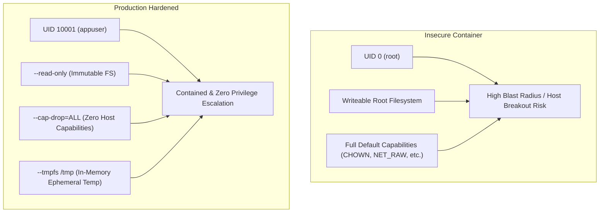

# Lab 4: Container Security & Least-Privilege Permissions

In this lab, you enforce enterprise container security standards: eliminating root privileges, preventing secret leakage, running with an immutable root filesystem, and dropping Linux kernel capabilities.

---

## 1. Why Container Security Matters

By default, containers execute as `root` (`UID 0`). Although Linux namespaces isolate the container, the container root user maps directly to the host's root user in the kernel unless user namespaces (`userns-remap`) are configured. 

If an attacker achieves Remote Code Execution (RCE) via a vulnerable Java dependency (e.g., Log4Shell or Spring4Shell):
- As **root**: The attacker can manipulate system files, probe local sockets, attempt container breakout exploits, and install malware.
- As an **unprivileged non-root user with read-only root FS and no capabilities**: The attacker cannot write to `/bin`, modify code, add cron jobs, or elevate permissions.



---

## 2. Security Controls Applied

### 1. Dedicated System User & Explicit UID/GID
```dockerfile
ARG UID=10001
ARG GID=10001
RUN addgroup -g ${GID} -S appgroup && \
    adduser -u ${UID} -S appuser -G appgroup -s /sbin/nologin
USER ${UID}:${GID}
```
Using high, explicit IDs (10000+) prevents collisions with host users and prevents privilege escalation.

### 2. Secret Mounts (`--mount=type=secret`)
Never pass API tokens or Maven credentials in `ARG` or `ENV`. Both are baked into the image history!
Instead, use BuildKit secrets:
```dockerfile
RUN --mount=type=secret,id=maven-settings,target=/root/.m2/settings.xml \
    mvn package
```
Build with:
```bash
docker buildx build -f labs/04-security-and-permissions/Dockerfile.hardened \
  --secret id=maven-settings,src=$HOME/.m2/settings.xml -t spring-boot-hardened:1.0 .
```

### 3. Read-Only Root Filesystem & Dropping Capabilities
When running the container:
```bash
docker run -d \
  --read-only \
  --tmpfs /tmp:rw,noexec,nosuid,size=64m \
  --cap-drop=ALL \
  --security-opt=no-new-privileges:true \
  -p 127.0.0.1:8080:8080 \
  spring-boot-hardened:1.0
```
- `--read-only`: Any attempt to write to disk is immediately blocked by the kernel.
- `--tmpfs /tmp`: Gives the JVM an ephemeral, memory-backed scratch space for Tomcat temp files, while blocking binary execution (`noexec`).
- `--cap-drop=ALL`: Strips all POSIX capabilities.
- `--security-opt=no-new-privileges:true`: Prevents processes from gaining additional privileges via `setuid` binaries.

---

## 3. Hands-On Exercise

### Step 1: Run the Automated Security Verification
Run the verification script to test non-root UID execution and immutable filesystem enforcement:
```bash
./labs/04-security-and-permissions/test-security.sh
```

Inspect the output to confirm that:
1. `id -u` reports `10001`.
2. Attempting to write `/app/malicious.txt` throws `Read-only file system`.
3. The Spring Boot health endpoint continues to function flawlessly!

---

## 4. Key Takeaways
- Always declare and switch to a non-root `USER` before `ENTRYPOINT`.
- Design containerized Java apps to run under `--read-only` filesystems by directing ephemeral I/O to `/tmp`.
- In **Lab 5**, we take security a step further: stripping the operating system entirely using **Google Distroless**!
