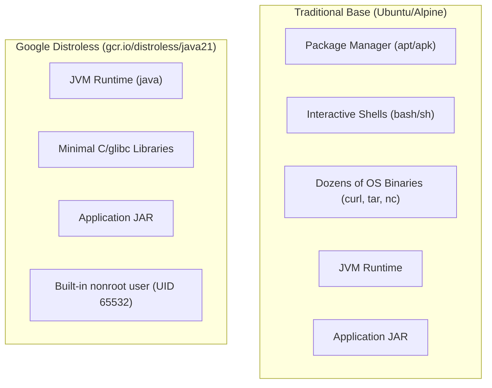

# Lab 5: Hardened Base Images & Google Distroless

In this lab, you migrate your Spring Boot container to **Google Distroless**, stripping away the shell, package managers, and standard OS utilities to achieve maximum container hardening.

---

## 1. The Distroless Philosophy

Why run an entire Linux operating system (Ubuntu, Debian, or even Alpine) just to run a single Java JAR?

Standard OS base images contain:
- Package managers (`apt`, `apk`, `dpkg`)
- System shells (`/bin/sh`, `/bin/bash`)
- File utilities (`curl`, `wget`, `nc`, `tar`)
- Hundreds of OS packages with potential CVEs

If an attacker achieves remote code execution in your application, their first move is almost universally to spawn a shell or download an external payload via `curl`/`wget`.

**Distroless images contain ONLY your application and its runtime dependencies.** There is no shell, no package manager, and no standard utilities.



---

## 2. Pinned Base Image Tags & Security

In `Dockerfile.distroless`:
```dockerfile
FROM gcr.io/distroless/java21-debian12:nonroot AS runtime
```
- `:nonroot`: Comes pre-configured to run as UID 65532 (`nonroot`).
- Zero shell binaries: `docker exec -it <container> sh` will fail with `executable file not found in $PATH`.

### How do you debug a shell-less container?
When an incident occurs in production, developers often ask: *"How do I inspect the container if there is no shell?"*
1. **Docker Debug (Docker Desktop 4.27+)**:
   ```bash
   docker debug <container-id>
   ```
   Attaches an ephemeral toolbox container containing busybox/curl into the target container's namespaces without modifying the base image.
2. **Kubernetes Ephemeral Containers**:
   ```bash
   kubectl debug -it <pod-name> --image=busybox:1.36 --target=<container-name>
   ```

---

## 3. Hands-On Exercise

### Step 1: Run the Distroless Verification Script
```bash
./labs/05-distroless-hardened/verify-no-shell.sh
```

Observe the test results:
1. The application starts and serves HTTP traffic on port 8080.
2. Executing `/bin/sh` or `apt-get` fails immediately because the binaries do not exist.

---

## 4. Key Takeaways
- Distroless dramatically reduces your vulnerability scan surface (but does not guarantee zero vulnerabilities).
- Next, in **Lab 6**, we solve a critical problem introduced by Distroless: *How do you write Docker HEALTHCHECKs and orchestrate graceful shutdowns when there is no `curl` or `sh` inside the image?*
